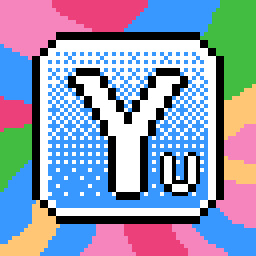

<section class="yuumix-section yuumix-section--hero" id="hero" data-mood="chill">
  

  

    
    

      
Yuumix 说:

      
嘿!我是 Yuumix,顺便做点 Unity 插件。

    

  

  <h1 class="yuumix-title">Y U U M I X</h1>
  
Runestone · 符文石 · Unity 插件作者

  <a href="#about" class="yuumix-cta">▶ 继续往下看</a>
  
▼ 向下滚动 ▼

</section>

<section class="yuumix-section yuumix-section--about" id="about" data-mood="chill">
  

    
    

      
Yuumix 说:

      
我是个独立开发者,做些能省时间的工具。

    

  

  

    <h2>关于我</h2>
    
独立 Unity 开发者,做工具、编辑器扩展、写写笔记。踩过的坑都记下来,省的以后再栽一次。

  

</section>

<section class="yuumix-section yuumix-section--showcase" id="showcase" data-mood="chill">
  

    
    

      
Yuumix 说:

      
在做的东西,给你看看!

    

  

  

    

      <h3>Aesir Inspector</h3>
      
基于 Odin Inspector 的编辑器扩展工具集,让检视面板像读符文石一样清楚。

      <ul class="px-show__list">
        <li>双语注释并排显示,中英文对照</li>
        <li>ScriptDoc Generator:字段注释自动生成文档</li>
        <li>Summary Tool:脚本一键汇总成面板</li>
      </ul>
      

        <a class="yuumix-cta" href="aesir-inspector/index.md">▶ 查看文档</a>
        <a class="px-show__link" href="https://github.com/yuumixcode/AesirInspector">GitHub ↗</a>
      

    

    

      

        <i></i><i></i><i></i>
        AESIR INSPECTOR
      

      

        
Max HP<b style="width:72%"></b><em>120</em>

        
Is Alive<b></b>

        
Move Speed<b style="left:58%"></b>

        
Weapon<em>RUNESTONE_SWORD ▾</em>

        
Runes<b></b><b></b><b class="is-dim"></b>

        

          APPLY
          READY_
        

      

    

  

  

    

      <h3>Aesir Framework</h3>
      
面向 Unity / 团结引擎的渐进式 MVC 框架:核心架构 RAA + 功能模块集 RAM,能力接口按需组合。

      <ul class="px-show__list">
        <li>Command / Query / ObservableValue 三类核心协议</li>
        <li>UI、场景、事件模块即插即用</li>
        <li>独立文档站,架构与模块说明分开维护</li>
      </ul>
      

        <a class="yuumix-cta" href="https://yuumixcode.github.io/AesirFramework-Site/">▶ 文档站</a>
        <a class="px-show__link" href="https://github.com/yuumixcode/AesirFramework">GitHub ↗</a>
      

    

    

      

        <i></i><i></i><i></i>
        AESIR FRAMEWORK · ARCH
      

      

        
RAM · UI / SCENE / EVENT MODULES

        
▼ COMMAND · QUERY ▼

        
RAA · ARCHITECTURE + OBSERVABLE

        
▼ CAPABILITY ▼

        
CORE · UNITY / TUANJIE RUNTIME

      

    

  

</section>

<section class="yuumix-section yuumix-section--explore" id="explore" data-mood="friendly">
  

    <h2>想去哪里?</h2>
    
挑一张卡,开始探索这个符文石小屋。

  

  

    <a class="yuumix-card" href="blog/index.md">
      <svg class="yuumix-card__icon" viewBox="0 0 8 8" shape-rendering="crispEdges" aria-hidden="true"><path d="M0 1h3v6H0zM5 1h3v6H5zM3 2h2v4H3z" fill="currentColor"/></svg>
      博客
      长文与社区分享:Odin 系列笔记、模型横评、GameJam 记录。
      ▶ 去看文章
    </a>
    <a class="yuumix-card" href="unity-knowledge/unity-packages/localization/unity-localization-pitfall-log.md">
      <svg class="yuumix-card__icon" viewBox="0 0 8 8" shape-rendering="crispEdges" aria-hidden="true"><path d="M1 2h6v1H1zM1 4h6v1H1zM1 6h6v1H1zM1 0h1v7H1zM6 0h1v7H6z" fill="currentColor"/></svg>
      Unity 知识库
      本地化踩坑日志、Addressables、依赖注入、场景管理等主题沉淀。
      ▶ 去翻笔记
    </a>
    <a class="yuumix-card" href="aesir-inspector/index.md">
      <svg class="yuumix-card__icon" viewBox="0 0 8 8" shape-rendering="crispEdges" aria-hidden="true"><path d="M2 0h4v1H2zM1 1h6v6H1zM3 3h2v2H3z" fill="currentColor"/></svg>
      Aesir Inspector
      双语注释、脚本文档生成、汇总面板——基于 Odin 的编辑器工具集。
      ▶ 看插件文档
    </a>
    <a class="yuumix-card" href="ai/index.md">
      <svg class="yuumix-card__icon" viewBox="0 0 8 8" shape-rendering="crispEdges" aria-hidden="true"><path d="M3 0h2v1H3zM1 1h6v5H1zM2 3h1v1H2zM5 3h1v1H5zM2 6h4v1H2z" fill="currentColor"/></svg>
      AI 笔记
      Skill 集成、文档转 PPT / 视频工作流、语音克隆等实操记录。
      ▶ 看 AI 实践
    </a>
    <a class="yuumix-card" href="zensical/index.md">
      <svg class="yuumix-card__icon" viewBox="0 0 8 8" shape-rendering="crispEdges" aria-hidden="true"><path d="M3 0h2v2H3zM1 2h2v2H1zM5 2h2v2H5zM0 4h2v2H0zM3 3h2v3H3zM6 4h2v2H6zM2 6h4v2H2z" fill="currentColor"/></svg>
      Zensical
      这个站点本身的制作笔记:字体、视频、部署与主题定制。
      ▶ 建站心得
    </a>
    <a class="yuumix-card" href="https://yuumixcode.github.io/AesirFramework-Site/">
      <svg class="yuumix-card__icon" viewBox="0 0 8 8" shape-rendering="crispEdges" aria-hidden="true"><path d="M0 0h8v2H0zM1 3h6v2H1zM2 6h4v2H2z" fill="currentColor"/></svg>
      Aesir Framework 文档站
      渐进式 MVC 框架的 Architecture 与 Modules 官方文档(独立站点)。
      ▶ 前往文档站
    </a>
  

</section>

<section class="yuumix-section yuumix-section--contact" id="contact" data-mood="friendly">
  

    
    

      
Yuumix 说:

      
想聊合作?来敲我!

    

  

</section>

